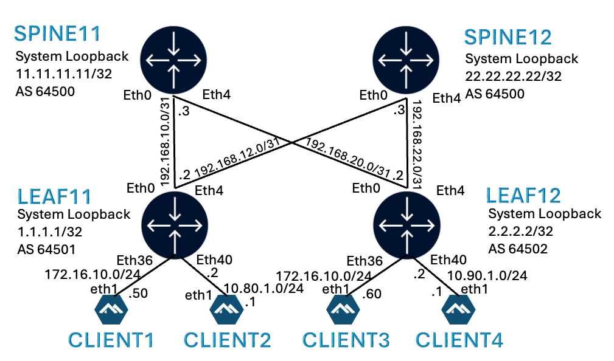
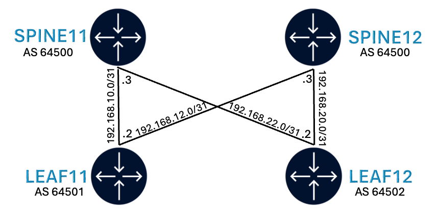
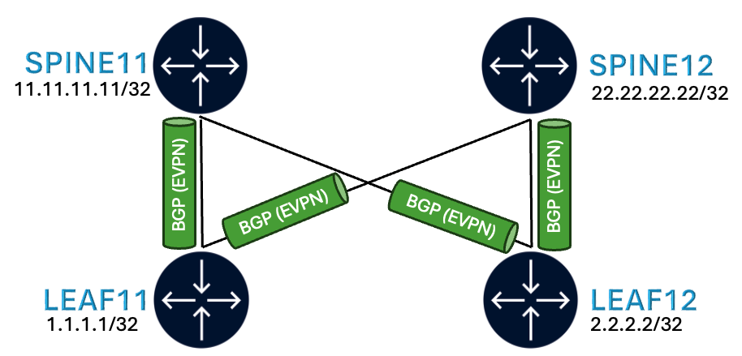

# Configuring BGP and EVPN on SONiC

## Physical link connectivity

To save time, we will use a script to configure the link IP addresses on all devices.

On your VM, go to:

```bash
cd ~/ac6-sonic/02-sonic-bgp-evpn
```

Then execute the script:

```bash
./deploy_fabric.sh
```

This script configures the link IP addresses on all 4 switches.

Check the [startup config](configs/) files to see how these objects are configured in SONiC.

Expected output:

```bash
========================================================
 ALL FOUR SONIC DEVICES DEPLOYED SUCCESSFULLY
========================================================
```

After logging in to `leaf11`, run the below command to view interface status:

```bash
show ip interfaces
```

Expected output:

```bash
Interface    Master    IPv4 address/mask    Admin/Oper    BGP Neighbor    Neighbor IP
-----------  --------  -------------------  ------------  --------------  -------------
Ethernet0              192.168.10.2/31      up/up         N/A             N/A
Ethernet4              192.168.12.2/31      up/up         N/A             N/A
Loopback0              1.1.1.1/32           up/up         N/A             N/A
docker0                240.127.1.1/24       up/down       N/A             N/A
eth0                   10.0.0.15/24         up/up         N/A             N/A
lo                     127.0.0.1/16         up/up         N/A             N/A
```

### IPv4 Link Addressing



### Verify reachability between devices

After the lab is deployed, check reachability between leaf and spine devices using ping.

Example on Leaf11 to spine11:

```bash
ping -c 3 192.168.10.3
```

## SONiC CLI Introduction

SONiC NOS has 2 main Command Line Interfaces:

- SONiC (default cli) - sample prompt `admin@leaf1:~$`

  The SONiC configuration stores VLANs, interfaces, VRFs, and VXLAN mappings. Configuration is saved in `config_db.json`.
  
  To save SONiC configuration run:

  ```bash
  sudo config save -y
  ```
- FRR (enter using `vtysh` from SONiC bash CLI) - sample prompt `leaf1#`

  FRR stores BGP EVPN configuration and is saved in `/etc/frr/frr.conf`

  To save FRR configuration run:

  ```bash
  sudo vtysh -c "write memory"
  ```

For all configuration and show commands listed in this workshop, we specify the CLI from where it should be executed.

## Configure BGP Underlay

We are now ready to start configuring the fabric for EVPN.

We will be using a mix of CLI and gNMI for configuration.

Leafs will be configured using CLI.

Spines will be configured using gNMI. All gNMI commands will be executed from the VM using `gnmic`.

The first step is to configure BGP for underlay.



### BGP Underlay Configuration

BGP configuration will be done from **Leaf11** and **Leaf12**`FRR` CLI. After logging into the node, enter `FRR` CLI using:

```bash
vtysh
```

Then, get into configuration mode by entering:

```bash
config
```

BGP underlay configuration on **Leaf11**:

```bash
router bgp 64501
 bgp router-id 1.1.1.1
 no bgp ebgp-requires-policy
 neighbor 192.168.10.3 remote-as 64500
 neighbor 192.168.12.3 remote-as 64500
 !
 address-family ipv4 unicast
  network 1.1.1.1/32
 exit-address-family
 !
exit
```

BGP underlay configuration on **Leaf12**:

```bash
router bgp 64502
 bgp router-id 2.2.2.2
 no bgp ebgp-requires-policy
 neighbor 192.168.20.3 remote-as 64500
 neighbor 192.168.22.3 remote-as 64500
 !
 address-family ipv4 unicast
  network 2.2.2.2/32
 exit-address-family
 !
exit
```

BGP underlay configuration on **Spine11** using gNMI:

Run the commands from the VM.

Configure BGP:

```bash
gnmic -a spine11:8080 --insecure \
  -e json_ietf set \
  --update-path 'sonic-db:/CONFIG_DB/localhost/BGP_GLOBALS/default' \
  --update-value '{"vrf_name":"default","local_asn":"64500","ebgp_requires_policy": "false","default_ipv4_unicast": "true","load_balance_mp_relax": "true","router_id": "11.11.11.11"}'
```

Configure BGP Address Family:

```bash
gnmic -a spine11:8080 --insecure \
  -e json_ietf set \
  --update-path 'sonic-db:/CONFIG_DB/localhost/BGP_GLOBALS_AF/default|ipv4_unicast' \
  --update-value '{"max_ebgp_paths": "64"}' \
  --update-path 'sonic-db:/CONFIG_DB/localhost/BGP_GLOBALS_AF_NETWORK' \
  --update-value '{"default|ipv4_unicast|11.11.11.11/32": {}}'
```

Configure BGP Neighbors:

```bash
gnmic -a spine11:8080 --insecure \
  -e json_ietf set \
  --update-path 'sonic-db:/CONFIG_DB/localhost/BGP_NEIGHBOR/default|192.168.10.2' \
  --update-value '{"asn": "64501"}' \
  --update-path 'sonic-db:/CONFIG_DB/localhost/BGP_NEIGHBOR/default|192.168.20.2' \
  --update-value '{"asn": "64502"}' \
  --update-path 'sonic-db:/CONFIG_DB/localhost/BGP_NEIGHBOR_AF/default|192.168.10.2|ipv4_unicast' \
  --update-value '{"admin_status": "up"}' \
  --update-path 'sonic-db:/CONFIG_DB/localhost/BGP_NEIGHBOR_AF/default|192.168.20.2|ipv4_unicast' \
  --update-value '{"admin_status": "up"}'
```

Verify on **Spine11** if configurations were updated:

```bash
gnmic -a spine11:8080 --insecure \
  -e json_ietf get \
  --path 'sonic-db:/CONFIG_DB/localhost/BGP_GLOBALS' \
  --path 'sonic-db:/CONFIG_DB/localhost/BGP_GLOBALS_AF' \
  --path 'sonic-db:/CONFIG_DB/localhost/BGP_GLOBALS_AF_NETWORK' \
  --path 'sonic-db:/CONFIG_DB/localhost/BGP_NEIGHBOR' \
  --path 'sonic-db:/CONFIG_DB/localhost/BGP_NEIGHBOR_AF'
```

<details>
<summary>Expected output on Spine11</summary>
 
```bash
[
  {
    "source": "spine11:8080",
    "timestamp": 1794854322410576861,
    "time": "2026-11-16T18:38:42.410576861Z",
    "updates": [
      {
        "Path": "sonic-db:/CONFIG_DB/localhost/BGP_GLOBALS",
        "values": {
          "CONFIG_DB/localhost/BGP_GLOBALS": {
            "default": {
              "default_ipv4_unicast": "true",
              "ebgp_requires_policy": "false",
              "load_balance_mp_relax": "true",
              "local_asn": "64500",
              "router_id": "11.11.11.11",
              "vrf_name": "default"
            }
          }
        }
      }
    ]
  },
  {
    "source": "spine11:8080",
    "timestamp": 1794854322410576861,
    "time": "2026-11-16T18:38:42.410576861Z",
    "updates": [
      {
        "Path": "sonic-db:/CONFIG_DB/localhost/BGP_GLOBALS_AF",
        "values": {
          "CONFIG_DB/localhost/BGP_GLOBALS_AF": {
            "default|ipv4_unicast": {
              "max_ebgp_paths": "64"
            }
          }
        }
      }
    ]
  },
  {
    "source": "spine11:8080",
    "timestamp": 1794854322410576861,
    "time": "2026-11-16T18:38:42.410576861Z",
    "updates": [
      {
        "Path": "sonic-db:/CONFIG_DB/localhost/BGP_GLOBALS_AF_NETWORK",
        "values": {
          "CONFIG_DB/localhost/BGP_GLOBALS_AF_NETWORK": {
            "default|ipv4_unicast|11.11.11.11/32": {}
          }
        }
      }
    ]
  },
  {
    "source": "spine11:8080",
    "timestamp": 1794854322410576861,
    "time": "2026-11-16T18:38:42.410576861Z",
    "updates": [
      {
        "Path": "sonic-db:/CONFIG_DB/localhost/BGP_NEIGHBOR",
        "values": {
          "CONFIG_DB/localhost/BGP_NEIGHBOR": {
            "default|192.168.10.2": {
              "asn": "64501"
            },
            "default|192.168.20.2": {
              "asn": "64502"
            }
          }
        }
      }
    ]
  },
  {
    "source": "spine11:8080",
    "timestamp": 1794854322410576861,
    "time": "2026-11-16T18:38:42.410576861Z",
    "updates": [
      {
        "Path": "sonic-db:/CONFIG_DB/localhost/BGP_NEIGHBOR_AF",
        "values": {
          "CONFIG_DB/localhost/BGP_NEIGHBOR_AF": {
            "default|192.168.10.2|ipv4_unicast": {
              "admin_status": "up"
            },
            "default|192.168.20.2|ipv4_unicast": {
              "admin_status": "up"
            }
          }
        }
      }
    ]
  }
]
```

</details>

Login to **Spine11**. Save the config and Reload.

```bash
sudo config save -y && sudo config reload -y
```

BGP underlay configuration on **Spine12** using gNMI:

Run the commands from the VM.

Configure BGP:

```bash
gnmic -a spine12:8080 --insecure \
  -e json_ietf set \
  --update-path 'sonic-db:/CONFIG_DB/localhost/BGP_GLOBALS/default' \
  --update-value '{"vrf_name":"default","local_asn":"64500","ebgp_requires_policy": "false","default_ipv4_unicast": "true","load_balance_mp_relax": "true","router_id": "22.22.22.22"}'
```

Configure BGP Address Family:

```bash
gnmic -a spine12:8080 --insecure \
  -e json_ietf set \
  --update-path 'sonic-db:/CONFIG_DB/localhost/BGP_GLOBALS_AF/default|ipv4_unicast' \
  --update-value '{"max_ebgp_paths": "64"}' \
  --update-path 'sonic-db:/CONFIG_DB/localhost/BGP_GLOBALS_AF_NETWORK' \
  --update-value '{"default|ipv4_unicast|22.22.22.22/32": {}}'
```

Configure BGP Neighbors:

```bash
gnmic -a spine12:8080 --insecure \
  -e json_ietf set \
  --update-path 'sonic-db:/CONFIG_DB/localhost/BGP_NEIGHBOR/default|192.168.12.2' \
  --update-value '{"asn": "64501"}' \
  --update-path 'sonic-db:/CONFIG_DB/localhost/BGP_NEIGHBOR/default|192.168.22.2' \
  --update-value '{"asn": "64502"}' \
  --update-path 'sonic-db:/CONFIG_DB/localhost/BGP_NEIGHBOR_AF/default|192.168.12.2|ipv4_unicast' \
  --update-value '{"admin_status": "up"}' \
  --update-path 'sonic-db:/CONFIG_DB/localhost/BGP_NEIGHBOR_AF/default|192.168.22.2|ipv4_unicast' \
  --update-value '{"admin_status": "up"}'
```

Verify on **Spine12** if configurations were updated:

```bash
gnmic -a spine12:8080 --insecure \
  -e json_ietf get \
  --path 'sonic-db:/CONFIG_DB/localhost/BGP_GLOBALS' \
  --path 'sonic-db:/CONFIG_DB/localhost/BGP_GLOBALS_AF' \
  --path 'sonic-db:/CONFIG_DB/localhost/BGP_GLOBALS_AF_NETWORK' \
  --path 'sonic-db:/CONFIG_DB/localhost/BGP_NEIGHBOR' \
  --path 'sonic-db:/CONFIG_DB/localhost/BGP_NEIGHBOR_AF'
```

<details>
<summary>Expected output on Spine12</summary>
 
```bash
[
  {
    "source": "spine12:8080",
    "timestamp": 1794854721601344247,
    "time": "2026-11-16T18:45:21.601344247Z",
    "updates": [
      {
        "Path": "sonic-db:/CONFIG_DB/localhost/BGP_GLOBALS",
        "values": {
          "CONFIG_DB/localhost/BGP_GLOBALS": {
            "default": {
              "default_ipv4_unicast": "true",
              "ebgp_requires_policy": "false",
              "load_balance_mp_relax": "true",
              "local_asn": "64500",
              "router_id": "22.22.22.22",
              "vrf_name": "default"
            }
          }
        }
      }
    ]
  },
  {
    "source": "spine12:8080",
    "timestamp": 1794854721601344247,
    "time": "2026-11-16T18:45:21.601344247Z",
    "updates": [
      {
        "Path": "sonic-db:/CONFIG_DB/localhost/BGP_GLOBALS_AF",
        "values": {
          "CONFIG_DB/localhost/BGP_GLOBALS_AF": {
            "default|ipv4_unicast": {
              "max_ebgp_paths": "64"
            }
          }
        }
      }
    ]
  },
  {
    "source": "spine12:8080",
    "timestamp": 1794854721601344247,
    "time": "2026-11-16T18:45:21.601344247Z",
    "updates": [
      {
        "Path": "sonic-db:/CONFIG_DB/localhost/BGP_GLOBALS_AF_NETWORK",
        "values": {
          "CONFIG_DB/localhost/BGP_GLOBALS_AF_NETWORK": {
            "default|ipv4_unicast|22.22.22.22/32": {}
          }
        }
      }
    ]
  },
  {
    "source": "spine12:8080",
    "timestamp": 1794854721601344247,
    "time": "2026-11-16T18:45:21.601344247Z",
    "updates": [
      {
        "Path": "sonic-db:/CONFIG_DB/localhost/BGP_NEIGHBOR",
        "values": {
          "CONFIG_DB/localhost/BGP_NEIGHBOR": {
            "default|192.168.12.2": {
              "asn": "64501"
            },
            "default|192.168.22.2": {
              "asn": "64502"
            }
          }
        }
      }
    ]
  },
  {
    "source": "spine12:8080",
    "timestamp": 1794854721601344247,
    "time": "2026-11-16T18:45:21.601344247Z",
    "updates": [
      {
        "Path": "sonic-db:/CONFIG_DB/localhost/BGP_NEIGHBOR_AF",
        "values": {
          "CONFIG_DB/localhost/BGP_NEIGHBOR_AF": {
            "default|192.168.12.2|ipv4_unicast": {
              "admin_status": "up"
            },
            "default|192.168.22.2|ipv4_unicast": {
              "admin_status": "up"
            }
          }
        }
      }
    ]
  }
]
```

</details>

Login to **Spine12**. Save the config and Reload.

```bash
sudo config save -y && sudo config reload -y
```

### BGP Underlay Verification

The BGP underlay sessions should be UP now. Check using the following command on **spine11**.

Login to `spine11` and change to FRR CLI using `vtysh`.

```bash
show bgp summary
```

The output below confirms that IPv4 BGP neighbor sessions are established between `spine11` and the 2 Leaf nodes.

```bash
IPv4 Unicast Summary:
BGP router identifier 11.11.11.11, local AS number 64500 VRF default vrf-id 0
BGP table version 5
RIB entries 5, using 640 bytes of memory
Peers 2, using 47 KiB of memory

Neighbor        V         AS   MsgRcvd   MsgSent   TblVer  InQ OutQ  Up/Down State/PfxRcd   PfxSnt Desc
192.168.10.2    4      64501         8         8        5    0    0 00:02:02            1        3 N/A
192.168.20.2    4      64502         8         8        5    0    0 00:02:02            1        3 N/A

Total number of neighbors 2
```

Now we are ready to configure the overlay.

## Configure BGP for Overlay

For establishing overlay BGP session between Leaf1 and Leaf2, we will use the Loopback0 IP of the Leaf nodes. These IPs are pre-configured as part of initial lab deployment and can be verified using `show interface Loopback0` command.



### BGP Overlay Configuration

BGP Overlay configuration on **Leaf11** using FRR CLI:

```bash
router bgp 64501
 neighbor 11.11.11.11 remote-as 64500
 neighbor 11.11.11.11 update-source Loopback0
 neighbor 11.11.11.11 ebgp-multihop 2
 neighbor 22.22.22.22 remote-as 64500
 neighbor 22.22.22.22 update-source Loopback0
 neighbor 22.22.22.22 ebgp-multihop 2
 !
 address-family l2vpn evpn
  neighbor 11.11.11.11 activate
  neighbor 22.22.22.22 activate
 exit-address-family
address-family ipv4 unicast
  no neighbor 11.11.11.11 activate
  no neighbor 22.22.22.22 activate
 !
exit
!
```

BGP Overlay configuration on **Leaf12** using FRR CLI:

```bash
router bgp 64502
 neighbor 11.11.11.11 remote-as 64500
 neighbor 11.11.11.11 update-source Loopback0
 neighbor 11.11.11.11 ebgp-multihop 2
 neighbor 22.22.22.22 remote-as 64500
 neighbor 22.22.22.22 update-source Loopback0
 neighbor 22.22.22.22 ebgp-multihop 2
 !
 address-family l2vpn evpn
  neighbor 11.11.11.11 activate
  neighbor 22.22.22.22 activate
 exit-address-family
address-family ipv4 unicast
  no neighbor 11.11.11.11 activate
  no neighbor 22.22.22.22 activate
 !
exit
!
```

BGP Overlay configuration on **Spine11** using gNMI:

Run the commands from the VM:

Configure BGP Neighbors:

```bash
gnmic -a spine11:8080 --insecure \
  -e json_ietf set \
  --update-path 'sonic-db:/CONFIG_DB/localhost/BGP_NEIGHBOR/default|1.1.1.1' \
  --update-value '{"asn": "64501","ebgp_multihop_ttl": "2","local_addr": "11.11.11.11"}' \
  --update-path 'sonic-db:/CONFIG_DB/localhost/BGP_NEIGHBOR/default|2.2.2.2' \
  --update-value '{"asn": "64502","ebgp_multihop_ttl": "2","local_addr": "11.11.11.11"}'
```

Configure BGP Neighbor Address Family:

```bash
gnmic -a spine11:8080 --insecure \
  -e json_ietf set \
  --update-path 'sonic-db:/CONFIG_DB/localhost/BGP_NEIGHBOR_AF/default|1.1.1.1|ipv4_unicast' \
  --update-value '{"admin_status": "down"}' \
  --update-path 'sonic-db:/CONFIG_DB/localhost/BGP_NEIGHBOR_AF/default|1.1.1.1|l2vpn_evpn' \
  --update-value '{"admin_status": "up"}' \
  --update-path 'sonic-db:/CONFIG_DB/localhost/BGP_NEIGHBOR_AF/default|2.2.2.2|ipv4_unicast' \
  --update-value '{"admin_status": "down"}' \
  --update-path 'sonic-db:/CONFIG_DB/localhost/BGP_NEIGHBOR_AF/default|2.2.2.2|l2vpn_evpn' \
  --update-value '{"admin_status": "up"}'
```

Login to **Spine11** and save the config and reload

```bash
sudo config save -y && sudo config reload -y
```

BGP Overlay configuration on **Spine12** using gNMI:

Run the commands from the VM:

Configure BGP Neighbors:

```bash
gnmic -a spine12:8080 --insecure \
  -e json_ietf set \
  --update-path 'sonic-db:/CONFIG_DB/localhost/BGP_NEIGHBOR/default|1.1.1.1' \
  --update-value '{"asn": "64501","ebgp_multihop_ttl": "2","local_addr": "22.22.22.22"}' \
  --update-path 'sonic-db:/CONFIG_DB/localhost/BGP_NEIGHBOR/default|2.2.2.2' \
  --update-value '{"asn": "64502","ebgp_multihop_ttl": "2","local_addr": "22.22.22.22"}'
```

Configure BGP Neighbor Address Family:

```bash
gnmic -a spine12:8080 --insecure \
  -e json_ietf set \
  --update-path 'sonic-db:/CONFIG_DB/localhost/BGP_NEIGHBOR_AF/default|1.1.1.1|ipv4_unicast' \
  --update-value '{"admin_status": "down"}' \
  --update-path 'sonic-db:/CONFIG_DB/localhost/BGP_NEIGHBOR_AF/default|1.1.1.1|l2vpn_evpn' \
  --update-value '{"admin_status": "up"}' \
  --update-path 'sonic-db:/CONFIG_DB/localhost/BGP_NEIGHBOR_AF/default|2.2.2.2|ipv4_unicast' \
  --update-value '{"admin_status": "down"}' \
  --update-path 'sonic-db:/CONFIG_DB/localhost/BGP_NEIGHBOR_AF/default|2.2.2.2|l2vpn_evpn' \
  --update-value '{"admin_status": "up"}'
```

Login to **Spine12** and save the config and reload.

```bash
sudo config save -y && sudo config reload -y
```

### BGP Overlay Verification

The BGP overlay sessions should be UP now. Check using the following command on Leaf11.

```bash
do show bgp l2vpn evpn summary
```

The output confirms that EVPN neighbor sessions are established to Loopback0 IP.

```bash
BGP router identifier 1.1.1.1, local AS number 64501 VRF default vrf-id 0
BGP table version 0
RIB entries 0, using 0 bytes of memory
Peers 2, using 47 KiB of memory

Neighbor        V         AS   MsgRcvd   MsgSent   TblVer  InQ OutQ  Up/Down State/PfxRcd   PfxSnt Desc
11.11.11.11     4      64500         3         4        0    0    0 00:00:27            0        0 N/A
22.22.22.22     4      64500         3         4        0    0    0 00:00:24            0        0 N/A

Total number of neighbors 2
```

## Configure L2 EVPN-VXLAN

Now that we have established our underlay and overlay connectivity, our next step is to configure the Layer 2 EVPN-VXLAN instance.

The objective is to establish a connection between Client 1 (connected to Leaf1) and Client 3 (connected to Leaf2).

### Configuring VXLAN

Configuring VXLAN on **Leaf11** - using **SONiC bash CLI**:

```bash
bash << 'EOF'
sudo config vxlan add vtep 1.1.1.1
sudo config vxlan evpn_nvo add nvo vtep
EOF
```

Configuring VXLAN on **Leaf12** - using **SONiC bash CLI**::

```bash
bash << 'EOF'
sudo config vxlan add vtep 2.2.2.2
sudo config vxlan evpn_nvo add nvo vtep
EOF
```

### Configuring Layer 2 EVPN-VXLAN

In this step, we will configure a mac-vrf or VLAN on each Leaf and add the client facing untagged interface along with the VXLAN tunnel interface to the VLAN instance.

| Node | VLAN | VNI | Access Port | Tagging |
|---|---:|---:|---|---|
| Leaf1 | `110` | `10110` | `Ethernet36` | untagged |
| Leaf2 | `110` | `10110` | `Ethernet36` | untagged |

EVPN-VXLAN configuration on **Leaf11** - using **SONiC bash CLI**:

```bash
bash << 'EOF'
sudo config vlan add 110
sudo config interface startup Ethernet36
sudo config vlan member add -u 110 Ethernet36
sudo config vxlan map add vtep 110 10110
sudo config save -y
EOF
```

EVPN-VXLAN configuration on **Leaf12** - using **SONiC bash CLI**:

```bash
bash << 'EOF'
sudo config vlan add 110
sudo config interface startup Ethernet36
sudo config vlan member add -u 110 Ethernet36
sudo config vxlan map add vtep 110 10110
sudo config save -y
EOF
```

Enable BGP to advertise VNI:

On **Leaf11**, run the following command **Using FRR CLI** (Enter `vtysh` and then `config`):

```bash
router bgp 64501
 address-family l2vpn evpn
  advertise-all-vni
```

On **Leaf12**, run the following command **Using FRR CLI** (Enter `vtysh` and then `config`):

```bash
router bgp 64502
 address-family l2vpn evpn
  advertise-all-vni
```

### Ping between Client 1 & 3

Verify if Client 3 is able to ping Client 1

Login to Client3 using:

```bash
ssh root@client3
```

Password is `password`

Ping Client1 IP from Client3.

```bash
ping -c 3 172.16.10.50
```

Output on Client3:

```bash
PING 172.16.10.50 (172.16.10.50) 56(84) bytes of data.
64 bytes from 172.16.10.50: icmp_seq=1 ttl=64 time=12.7 ms
64 bytes from 172.16.10.50: icmp_seq=2 ttl=64 time=7.13 ms
64 bytes from 172.16.10.50: icmp_seq=3 ttl=64 time=5.20 ms

--- 172.16.10.50 ping statistics ---
3 packets transmitted, 3 received, 0% packet loss, time 2002ms
rtt min/avg/max/mdev = 5.198/8.357/12.741/3.198 ms
```

## Configure Layer 3 EVPN-VXLAN

Our final step in this section is to configure a Layer 3 EVPN-VXLAN.

The objective is to connect Client 2 and Client 4 over a Layer 3 EVPN.

### Configure MAC-VRF and Client interface

Client2 & 4 are Layer 3 clients with IPs in different subnets.

Client2 Layer 3 interface configuration on **Leaf11**:

Using **SONiC bash CLI**:

```bash
bash << 'EOF'
sudo config vlan add 200
sudo config interface startup Ethernet40
sudo config vlan member add -u 200 Ethernet40
EOF
```

Client4 Layer 3 interface configuration on **Leaf12**:

Using **SONiC bash CLI**:

```bash
bash << 'EOF'
sudo config vlan add 240
sudo config interface startup Ethernet40
sudo config vlan member add -u 240 Ethernet40
EOF
```

IP addresses on the client side are pre-configured during deployment. This can be verified by logging in to the Client and running `ip a`.

### Configuring VXLAN

VXLAN tunnels were configured as part of Layer 2 section.

### Configuring Layer 3 EVPN-VXLAN

We will include the client facing interface and the vxlan tunnel in this instance.

EVPN-VXLAN configuration on **Leaf11**:

Using **SONiC bash CLI**:

```bash
bash << 'EOF'
sudo config vrf add Vrf_Type5
sudo config interface vrf bind Vlan200 Vrf_Type5
sudo config interface ip add Vlan200 10.80.1.254/24
sudo config vlan add 999
sudo config interface vrf bind Vlan999 Vrf_Type5
sudo config vxlan map add vtep 200 10200
sudo config vxlan map add vtep 999 10999
sudo config vrf add_vrf_vni_map Vrf_Type5 10999
sudo config save -y
EOF
```

EVPN-VXLAN configuration on **Leaf12**:

Using **SONiC bash CLI**:

```bash
bash << 'EOF'
sudo config vrf add Vrf_Type5
sudo config interface vrf bind Vlan240 Vrf_Type5
sudo config interface ip add Vlan240 10.90.1.254/24
sudo config vlan add 999
sudo config interface vrf bind Vlan999 Vrf_Type5
sudo config vxlan map add vtep 240 10240
sudo config vxlan map add vtep 999 10999
sudo config vrf add_vrf_vni_map Vrf_Type5 10999
sudo config save -y
EOF
```

### Configuring VRF in BGP

VRF configuration on **Leaf11**:

Using **FRR CLI**:

```bash
vrf Vrf_Type5
 ip router-id 1.1.1.1
 vni 10999
 ip nht resolve-via-default
 ipv6 nht resolve-via-default
exit-vrf
router bgp 64501 vrf Vrf_Type5
 no bgp ebgp-requires-policy

 address-family ipv4 unicast
  network 10.80.1.0/24
 exit-address-family

 address-family l2vpn evpn
  advertise ipv4 unicast
  rd 1.1.1.1:10999
  route-target import 64999:10999
  route-target export 64999:10999
 exit-address-family
exit
```

VRF configuration on **Leaf12**:

Using **FRR CLI**:

```bash
vrf Vrf_Type5
 ip router-id 2.2.2.2
 vni 10999
 ip nht resolve-via-default
 ipv6 nht resolve-via-default
exit-vrf
router bgp 64502 vrf Vrf_Type5
 no bgp ebgp-requires-policy

 address-family ipv4 unicast
  network 10.90.1.0/24
 exit-address-family

 address-family l2vpn evpn
  advertise ipv4 unicast
  rd 2.2.2.2:10999
  route-target import 64999:10999
  route-target export 64999:10999
 exit-address-family
exit
```
### Verify routes are present under vrf Vrf_Type5
Log into **Leaf11** and **Leaf12**

```bash
show ip route vrf Vrf_Type5 bgp
```

Expected output
```bash
leaf11# show ip route vrf Vrf_Type5 bgp
B>* 10.90.1.0/24 [20/0] via 2.2.2.2, Vlan999 onlink, weight 1, 00:33:36
                        via 2.2.2.2, Vlan999 onlink (dup), weight 1, 00:33:36

leaf12# show ip route vrf Vrf_Type5 bgp
B>* 10.80.1.0/24 [20/0] via 1.1.1.1, Vlan999 onlink, weight 1, 00:28:52
                        via 1.1.1.1, Vlan999 onlink (dup), weight 1, 00:28:52
```

### Ping between Client 2 & 4

Login to client2 using:

```bash
ssh root@client2
```

Ping Client4 IP from Client2:

```bash
ping -c 3 10.90.1.1
```

Expected output:

```bash
PING 10.90.1.1 (10.90.1.1) 56(84) bytes of data.
64 bytes from 10.90.1.1: icmp_seq=1 ttl=62 time=4.18 ms
64 bytes from 10.90.1.1: icmp_seq=2 ttl=62 time=2.28 ms
64 bytes from 10.90.1.1: icmp_seq=3 ttl=62 time=2.07 ms

--- 10.90.1.1 ping statistics ---
3 packets transmitted, 3 received, 0% packet loss, time 2002ms
rtt min/avg/max/mdev = 2.066/2.842/4.184/0.952 ms
```

This completes the BGP and EVPN section.

## Next Section:   [gNMI with SONiC](https://github.com/srlinuxamericas/ac6-sonic/tree/main/03-sonic-gnmi)
