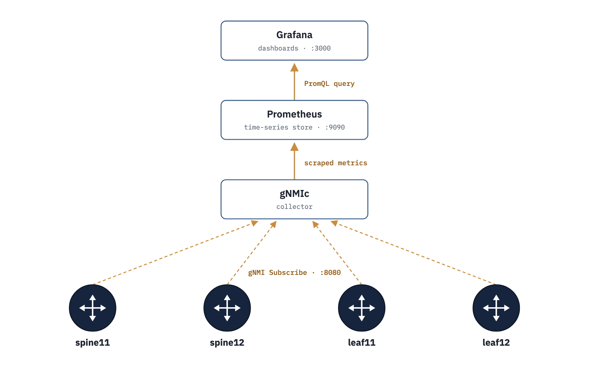

# SONiC Visibility and Telemetry


## gNMI Subscribe

The Subscribe RPC is the most commonly used gNMI RPC and provides Streaming Telemetry.





**Accessing Grafana:**

Using the browser : <id>.workxshop.net:3000
  .User:admin
  .Password: admin
(skip changing the password step) 


We will try 2 different telemetry options during this workshop.

### Sample

If we need a continous stream of a counter, we will use the `SAMPLE` option along with a specific interval.

The following command streams the in packets value every 5 seconds for interface `Ethernet0` on `spine11`.

```bash
gnmic -a spine11:8080   -u admin -p admin   --insecure   subscribe   --target COUNTERS_DB   --mode stream   --stream-mode sample   --sample-interval 5s --path "COUNTERS/Ethernet0/SAI_PORT_STAT_IF_IN_UCAST_PKTS"
```

The streaming session can be stopped using `CTRL+c`.


### On change

In some cases, we only want a counter when the value has changed. For example, after a new interface is configured, the in packets will be 0 until a protocol and neighbor are established. There is no benefit in streaming continous zeros.

This is where the `ON-CHANGE` option comes to the rescue.

When this option is enabled, the system will only stream data when the value of the object has changed.

Let us stream the same in packets counter using this method.

```bash
gnmic -a spine11:8080   -u admin -p admin   --insecure   subscribe   --target COUNTERS_DB   --mode stream   --stream-mode on-change   --path "COUNTERS/Ethernet0/SAI_PORT_STAT_IF_IN_UCAST_PKTS"
```

You will notice that the system is not streaming this counter as there is no change in the counter value.

Keep the streaming session going and open another window to `leaf11`. Start a ping from `leaf11` to the `spine11` interface.

On **leaf11**:

```bash
ping 192.168.10.3
```

While ping is in progress, check the streaming output. There should be a continous stream of the counter for every increment in the packet count.

Stop the ping using `CTRL+c` and check the streaming output again. The stream has slowed down or is not streaming any more as there is no change in the counter value.

Stop the streaming session using `CTRL+c`.


## Next Section:   [SONiC PCAP](https://github.com/srlinuxamericas/ac6-sonic/tree/main/05-sonic-pcap)
