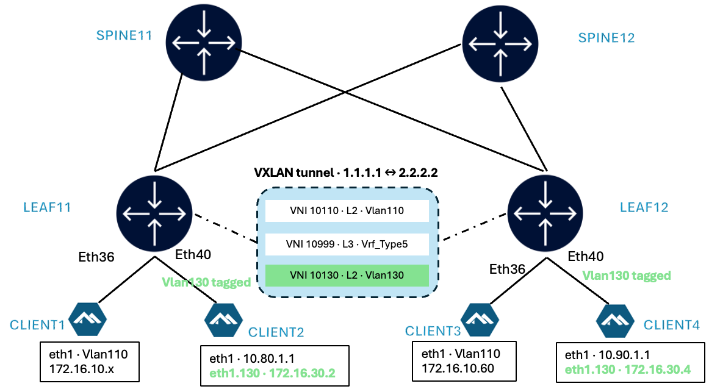

# Ansible with SONiC
The objective of this section is to show practical automation use cases for a SONIC based Fabric.

It shows how to use the switches' management layer using gNMI and SSH (where gNMI is not supported).

Using Ansible playbooks you will be able to collect and read the network state, make changes and verify the result without logging into each switch. 

## Use cases :

### 1 - Network Inventory

Collect network inventory that include:

- switches in the fabric
- ports
- interfaces
- IP addresses
- BGP sessions
- VLAN to VNI mapping
  
Automation Files:

|File|Description|
|---|---|
|hosts|inventory file|
|getinventory.yml|Playbook|
|fabric-inventory.txt| Output Report|

Running the playbook:

Change to the directory:

```bash
cd ~/ac6-sonic/05-sonic-automation/
```

Run the playbook:

```bash
sudo ansible-playbook -i hosts getinventory.yml
```

Verify the result:

```bash
cat fabric-inventory.txt
```

You can compare it with [this output](fabric-inventory.txt)


### 2 - Multi-Tenants: Provisioning a tenant segment

In this use case, we simulate on-boarding a new tenant.

Typically, a new tenant is assigned a new VLAN and associated configurations.

Rather than using CLI to login to each leaf and configure the new tenant, we will use Ansible playbook and push the configuration using gNMI.

The playbook will configure the following:

1. Create VLAN (130) on leaf11 and leaf12
2. Map the VLAN to the VNI on both leaves.
3. Add the tenant's port to the VLAN





Automation Files:

|File|Description|
|---|---|
|hosts|Inventory file|
|settenant.yml|Playbook|
|ansible.cfg |Configuration|

Prior to adding the tenant, let's verify the following on **Leaf11**  and on **Leaf12** using **SONiC CLI** 

Verify the VLAN members 

```bash
show vlan brief
```

Expected: VLANs 110, 200 and 999 — no VLAN 130 on **Leaf11**
Expected: VLANs 110, 240 and 999 — no VLAN 130 on **Leaf12**

<pre>
+-----------+----------------+------------+----------------+-------------+-----------------------+
|   VLAN ID | IP Address     | Ports      | Port Tagging   | Proxy ARP   | DHCP Helper Address   |
+===========+================+============+================+=============+=======================+
|       110 |                | Ethernet36 | untagged       | disabled    |                       |
+-----------+----------------+------------+----------------+-------------+-----------------------+
|       200 | 10.80.1.254/24 | Ethernet40 | untagged       | disabled    |                       |
+-----------+----------------+------------+----------------+-------------+-----------------------+
|       999 |                |            |                | disabled    |                       |
+-----------+----------------+------------+----------------+-------------+-----------------------+
</pre>

Verify VNI mapping:

```bash
show vxlan vlanvnimap
```

Expected: No  Vlan130 mapping 

<pre>
+---------+-------+
| VLAN    |   VNI |
+=========+=======+
| Vlan110 | 10110 |
+---------+-------+
| Vlan200 | 10200 |
+---------+-------+
| Vlan999 | 10999 |
+---------+-------+
Total count : 3
</pre>  

Verify EVPN VNIs known to FRR

```
vtysh -c "show evpn vni"
```

expected: 
<pre>
VNI        Type VxLAN IF              # MACs   # ARPs   # Remote VTEPs  Tenant VRF                                                   
10110      L2   vtep-110              0        1        1               default                              
10200      L2   vtep-200              1        2        0               Vrf_Type5                            
10999      L3   vtep-999              1        1        n/a             Vrf_Type5 
</pre>


Note: you can run the inventory report before and after for full baseline:

```
ansible-playbook -i hosts getinventory.yml
```
**Save the baseline: copy the report under a different name so the next run doesn’t overwrite it.** 
```
sudo cp fabric-inventory.txt fabric-before.txt
```

Add the tenant to with vlan_id 130

```
ansible-playbook -i hosts set-tenant.yml -e vlan_id=130 -e tagging=tagged
```

Verify (run the previous verify commands) 
<pre>
   - show vlan brief — VLAN 130 appears, Ethernet40 tagged
   - show vxlan vlanvnimap — Vlan130 → 10130, total count 4
   - vtysh -c "show evpn vni" — a new 10130 L2 row on vtep-130, tenant VRF default
</pre>  

Test the ping:  ping client 4 from **client2** 
```
ping -c 3 172.16.30.4
```
Result:
<pre>
      client2:~# ping -c 3 172.16.30.4
      PING 172.16.30.4 (172.16.30.4) 56(84) bytes of data.
      64 bytes from 172.16.30.4: icmp_seq=1 ttl=64 time=2.61 ms
      64 bytes from 172.16.30.4: icmp_seq=2 ttl=64 time=2.04 ms
      64 bytes from 172.16.30.4: icmp_seq=3 ttl=64 time=2.00 ms
</pre>


## Next Section:   [SONiC Maintenance](https://github.com/srlinuxamericas/ac6-sonic/tree/main/06-sonic-mw)


 
