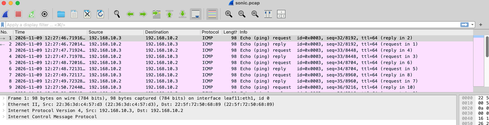
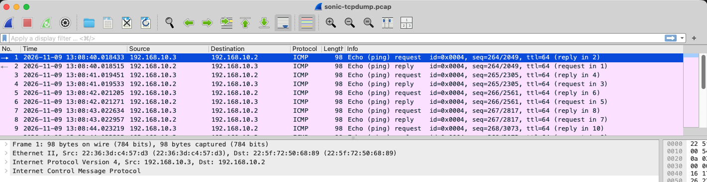

# Packet Capture in SONiC

In this section, we will review the packet capture options.

## Pcap in Containerlab

As we are using Containerlab for running this SONiC lab, we will try the pcap options in Containerlab first.

The latest version of Containerlab (0.83) has built in pcap tools using `containerlab capture` option.

Let's take a pcap of the `Ethernet0` interface on `leaf11` towards `spine11`.

Before we take the capture, let's use another new feature in Containerlab to check the interface status.

On our VM, run:

```bash
containerlab inspect interfaces --name ac6-sonic --node leaf11
```

In the above command, `--name` refers to the name given to the lab and using `--node` option, we are querying for `leaf11` interfaces.

Expected output:

```bash
11:36:31 INFO Parsing & checking topology file=ac6-sonic.clab.yml
╭────────────────┬───────┬───────┬───────────────────┬───────┬───────┬────────┬─────────╮
│ Container Name │  Name │ Alias │        MAC        │ Index │   MTU │  Type  │  State  │
├────────────────┼───────┼───────┼───────────────────┼───────┼───────┼────────┼─────────┤
│ leaf11         │ eth0  │ N/A   │ aa:c1:ab:5a:d0:40 │     2 │  1500 │ veth   │ up      │
│                ├───────┼───────┼───────────────────┼───────┼───────┼────────┼─────────┤
│                │ eth1  │ N/A   │ aa:c1:ab:98:27:c1 │  2331 │  9500 │ veth   │ up      │
│                ├───────┼───────┼───────────────────┼───────┼───────┼────────┼─────────┤
│                │ eth10 │ N/A   │ aa:c1:ab:fd:38:e3 │  2339 │  9500 │ veth   │ up      │
│                ├───────┼───────┼───────────────────┼───────┼───────┼────────┼─────────┤
│                │ eth11 │ N/A   │ aa:c1:ab:3e:2b:5f │  2345 │  9500 │ veth   │ up      │
│                ├───────┼───────┼───────────────────┼───────┼───────┼────────┼─────────┤
│                │ eth2  │ N/A   │ aa:c1:ab:05:bf:a6 │  2344 │  9500 │ veth   │ up      │
│                ├───────┼───────┼───────────────────┼───────┼───────┼────────┼─────────┤
│                │ lo    │ N/A   │                   │     1 │ 65536 │ device │ unknown │
│                ├───────┼───────┼───────────────────┼───────┼───────┼────────┼─────────┤
│                │ tap1  │ N/A   │ 0a:90:76:0d:d0:f9 │     3 │ 65000 │ tuntap │ unknown │
│                ├───────┼───────┼───────────────────┼───────┼───────┼────────┼─────────┤
│                │ tap10 │ N/A   │ 0e:7b:03:9f:20:05 │     5 │ 65000 │ tuntap │ unknown │
│                ├───────┼───────┼───────────────────┼───────┼───────┼────────┼─────────┤
│                │ tap11 │ N/A   │ 36:04:b0:03:e8:41 │     6 │ 65000 │ tuntap │ unknown │
│                ├───────┼───────┼───────────────────┼───────┼───────┼────────┼─────────┤
│                │ tap2  │ N/A   │ e6:9a:c5:81:1b:67 │     4 │ 65000 │ tuntap │ unknown │
╰────────────────┴───────┴───────┴───────────────────┴───────┴───────┴────────┴─────────╯
```

This table provides the list of interfaces managed in Containerlab for `leaf11`.

Here we see the Containerlab mapped interface names for SONiC. `eth0` is the management port, `eth1` maps to the first data port Ethernet0, `eth2` to Ethernet4 and so on.

Now, we need to take a packet capture on `Ethernet0` which is `eth1` in Containerlab.

Login to `spine11` and start a ping towards the `leaf11` interface.

On **spine11**:

```bash
ping 192.168.10.2
```

On your VM, run:

```bash
containerlab capture --name ac6-sonic   --target leaf11:eth1 --duration 10s -w sonic.pcap
```

This command takes a packet capture for 10 seconds and writes it to a file called `sonic.pcap` on the VM.

After 10 seconds, the command exits.

Transfer the pcap file to your laptop and open it using wireshark to look at the contents.



## Pcap in SONiC

SONiC runs on top of a Debian kernel and therefore you have access to all standard linux tools for troubleshooting.

`tcpdump` is available in SONiC for packet capture.

Let's run `tcpdump` natively in SONiC.

Keep the above ping running.

Run the below command on **leaf11**:

```bash
tcpdump -v -i Ethernet0
```

Expected output:

```bash
tcpdump: listening on Ethernet0, link-type EN10MB (Ethernet), snapshot length 262144 bytes
18:06:48.838619 IP (tos 0x0, ttl 64, id 7486, offset 0, flags [DF], proto ICMP (1), length 84)
    192.168.10.3 > 192.168.10.2: ICMP echo request, id 4, seq 153, length 64
18:06:48.838682 IP (tos 0x0, ttl 64, id 31471, offset 0, flags [none], proto ICMP (1), length 84)
    192.168.10.2 > 192.168.10.3: ICMP echo reply, id 4, seq 153, length 64
```

Stop the packet capture uisng `CTRL+c`.

Next, we will run `tcpdump` remotely on a SONiC switch and write to a local file on our VM.

Keep the ping running from spine11 to leaf11.

Run the below command from the VM:

```bash
ssh admin@leaf11 "sudo timeout 10 tcpdump -i Ethernet0 -U -w -" > sonic-tcpdump.pcap
```

Wait for 10 seconds for the command to complete.

This commands captures the packets for 10 seconds and writes them to a file called `sonic-tcpdump.pcap` on the VM.

Transfer the pcap file to your laptop and open it using wireshark to look at the contents.



This completes the Packet capture section.

## Next Section:   [SONiC Maintenance](https://github.com/srlinuxamericas/ac6-sonic/tree/main/06-sonic-mw)
