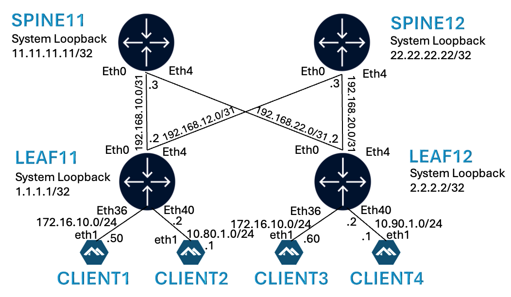
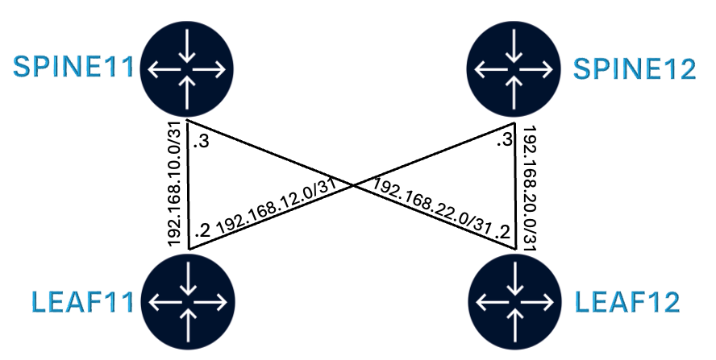

# Operationalizing SONiC in Modern Data Centers

Welcome to the workshop on *Operationalizing SONiC in Modern Data Centers* at Network Automation Forum's Autocon 6.

This README is your starting point into the hands on section.

Pre-requisite: A laptop with SSH client

If you need help, please raise your hand and a Nokia team member will be happy to assist.

Shortcut links to major sections in this README:

|   |   |
|---|---|
| [Lab Topology](#lab-topology) | [Building SONiC image](#Building-SONiC-container-image) |
| [Lab Topology](#lab-topology) | [Deploying the lab](#0-deploying-the-sonic-lab) |

## Lab Environment

A Nokia team member will provide you with a card that contains:
- your VM hostname
- SSH credentials to the VM instance
- URL of this repo

> <p style="color:red">!!! Make sure to backup any code, config, ... <u> offline (e.g on your laptop)</u>. 
> The VM instances will be destroyed once the Workshop is concluded.</p>

## Workshop
The objective of the hands on section of this workshop is the following:
- Build a SONiC image for Containerlab
- Deploy a SONiC leaf-spine fabric with Containerlab
- Configure EVPN on SONiC
- Use gNMI for configuration and streaming Telemetry
- SONiC observability using dashboards
- Automate configuration tasks
- Simulate a Maintenance operation

## Lab Topology

Each workshop participant will be provided with the below topology consisting of 2 leaf and 2 spines nodes along with 2 clients. The Leaf-Spine architecture is typical in a Data Center environment and clients are simulating workloads or VMs.


## NOS (Network Operating System)

All 4 switch nodes will be running the latest SONiC 202605 release.

SONiC NOS has 2 main Command Line Interfaces:

- SONiC (default cli) - sample prompt `admin@leaf1:~$`

  The SONiC configuration stores VLANs, interfaces, VRFs, and VXLAN mappings. Configuration is saved in `config_db.json`.
  
  To save SONiC configuration run:

  ```bash
  sudo config save -y
  ```
- FRR (enter using `vtysh` from SONiC bash CLI) - sample prompt `leaf1#`

  FRR stores BGP EVPN configuration and is saved in `/etc/frr/frr.conf`

  To save FRR configuration run:

  ```bash
  sudo vtysh -c "write memory"
  ```

For all configuration and show commands listed in this workshop, we specify the CLI from where it should be executed.

All 4 clients will be running [Alpine Linux](https://alpinelinux.org/)

## VM-based nodes in containerlab

VM nodes integration in containerlab is based on the [hellt/vrnetlab](https://github.com/hellt/vrnetlab) project which is a fork of `vrnetlab/vrnetlab` where things were added to make it work with the container networking.

Start with cloning the project:

```bash
cd ~ && git clone https://github.com/hellt/vrnetlab.git && \
cd ~/vrnetlab
```

### Building SONiC container image

SONiC vs image (downloaded from [sonic.software](https://sonic.software/)) is located at `~/images/sonic-vs-202605.qcow2` on your VM and should be copied to the `~/vrnetlab/sonic/` directory before building the container image.

```bash
cp ~/images/sonic-vs-202605.qcow2 ~/vrnetlab/sonic/
```

Once copied, we can enter in the `~/vrnetlab/sonic` image and build the container image:

```bash
cd ~/vrnetlab/sonic && make
```

The resulting image will be tagged as `vrnetlab/sonic_sonic-vs:202405`. This can be verified using `docker images` command.

```bash
REPOSITORY                TAG       IMAGE ID       CREATED          SIZE
vrnetlab/sonic_sonic-vs   202605    33b73b1dadc4   5 minutes ago    6.37GB
```

### Using Codespaces

This lab can be deployed using GitHub Codespaces. Once you are logged into GitHub, click the below icon and wait for 2 minutes for codespaces to be ready.

Refer to instructions in the [Codespace](./Codespace) directory for importing the sonic image.

---
<div align=center>
<a href="https://codespaces.new/srlinuxamericas/ac6-sonic?quickstart=1">
</a>

**[Run](https://codespaces.new/srlinuxamericas/ac6-sonic?quickstart=1) this lab in GitHub Codespaces for free**.  
[Learn more](https://containerlab.dev/manual/codespaces/) about Containerlab for Codespaces.

</div>

---


## Deploying the SONiC lab

With the sonic image built, we can proceed with the lab deployment. We will deploy a lab with SONiC and SR Linux to show that Containerlab can have a VM based docker node and a native docker node in the same lab.

Use the below command to clone this repo to your VM.

```bash
sudo git clone https://github.com/srlinuxamericas/ac6-sonic.git
```

Verify that the git repo files are available on your VM.

```bash
ls -lrt ac6-sonic/
```

Now lets deploy the lab:

```bash
cd ac6-sonic
sudo clab dep -c
```

At the end of the deployment, the following table will be displayed. Wait for the sonic boot to be completed (see next section), before trying to login to sonic.

```bash
╭────────────────┬─────────────────────────────────────────────┬────────────────────┬────────────────╮
│      Name      │                  Kind/Image                 │        State       │ IPv4/6 Address │
├────────────────┼─────────────────────────────────────────────┼────────────────────┼────────────────┤
│ client11       │ linux                                       │ running            │ 172.40.40.10   │
│                │ ghcr.io/mfzhsn/network-multitool-sshd:0.0.5 │                    │ N/A            │
├────────────────┼─────────────────────────────────────────────┼────────────────────┼────────────────┤
│ client12       │ linux                                       │ running            │ 172.40.40.11   │
│                │ ghcr.io/mfzhsn/network-multitool-sshd:0.0.5 │                    │ N/A            │
├────────────────┼─────────────────────────────────────────────┼────────────────────┼────────────────┤
│ client13       │ linux                                       │ running            │ 172.40.40.12   │
│                │ ghcr.io/mfzhsn/network-multitool-sshd:0.0.5 │                    │ N/A            │
├────────────────┼─────────────────────────────────────────────┼────────────────────┼────────────────┤
│ client14       │ linux                                       │ running            │ 172.40.40.13   │
│                │ ghcr.io/mfzhsn/network-multitool-sshd:0.0.5 │                    │ N/A            │
├────────────────┼─────────────────────────────────────────────┼────────────────────┼────────────────┤
│ gnmic          │ linux                                       │ running            │ 172.40.40.6    │
│                │ ghcr.io/openconfig/gnmic:0.47.0             │                    │ N/A            │
├────────────────┼─────────────────────────────────────────────┼────────────────────┼────────────────┤
│ gnmic-counters │ linux                                       │ running            │ 172.40.40.8    │
│                │ ghcr.io/openconfig/gnmic:0.47.0             │                    │ N/A            │
├────────────────┼─────────────────────────────────────────────┼────────────────────┼────────────────┤
│ grafana        │ linux                                       │ running            │ 172.40.40.9    │
│                │ grafana/grafana:latest                      │                    │ N/A            │
├────────────────┼─────────────────────────────────────────────┼────────────────────┼────────────────┤
│ leaf11         │ sonic-vm                                    │ running            │ 172.40.40.2    │
│                │ vrnetlab/sonic_sonic-vs:202605              │ (health: starting) │ N/A            │
├────────────────┼─────────────────────────────────────────────┼────────────────────┼────────────────┤
│ leaf12         │ sonic-vm                                    │ running            │ 172.40.40.4    │
│                │ vrnetlab/sonic_sonic-vs:202605              │ (health: starting) │ N/A            │
├────────────────┼─────────────────────────────────────────────┼────────────────────┼────────────────┤
│ prometheus     │ linux                                       │ running            │ 172.40.40.7    │
│                │ quay.io/prometheus/prometheus:v2.54.1       │                    │ N/A            │
├────────────────┼─────────────────────────────────────────────┼────────────────────┼────────────────┤
│ spine11        │ sonic-vm                                    │ running            │ 172.40.40.3    │
│                │ vrnetlab/sonic_sonic-vs:202605              │ (health: starting) │ N/A            │
├────────────────┼─────────────────────────────────────────────┼────────────────────┼────────────────┤
│ spine12        │ sonic-vm                                    │ running            │ 172.40.40.5    │
│                │ vrnetlab/sonic_sonic-vs:202605              │ (health: starting) │ N/A            │
╰────────────────┴─────────────────────────────────────────────┴────────────────────┴────────────────╯
```

### Monitoring the boot process

To monitor the boot process of SONiC, you can open a new terminal and run the following command:

```bash
sudo docker logs -f leaf11
```

> the SONiC boot time is approximately 1 minute.

Wait for the following message to appear in the boot logs which indicates the completion of the boot process and that the node is ready for login.

Verify that the below line is displayed on all 4 switches.

```bash
2026-11-04 16:25:23,960: launch         INFO Startup complete in: 0:01:46.508883
```

## Connecting to the nodes

To connect to SONiC node:

```bash
ssh admin@leaf11
```

Refer to the password in your card.

To login to any of the clients - `client1`, `client2`, `client3`, `client4`:

Username: `root`

Password: 'password'

Example:

```bash
ssh root@client1
```

Login to all 4 switches and verify the internal docker container for sonic functions are running:

```bash
docker ps
```

Expected output on each switch:

```bash
CONTAINER ID   IMAGE                                COMMAND                  CREATED              STATUS              PORTS     NAMES
8e11bc49d81e   docker-snmp:latest                   "/usr/bin/docker-snm…"   About a minute ago   Up About a minute             snmp
d7ba1f71b097   docker-platform-monitor:latest       "/usr/bin/docker_ini…"   About a minute ago   Up About a minute             pmon
5bb439d2bf1c   docker-sonic-mgmt-framework:latest   "/usr/local/bin/supe…"   About a minute ago   Up About a minute             mgmt-framework
4661015d8f25   docker-lldp:latest                   "/usr/bin/docker-lld…"   About a minute ago   Up About a minute             lldp
2321a0f89ada   docker-eventd:latest                 "/usr/local/bin/supe…"   3 minutes ago        Up 2 minutes                  eventd
e857528484b3   docker-gbsyncd-vs:latest             "/usr/local/bin/supe…"   3 minutes ago        Up 3 minutes                  gbsyncd
a6b4ed4259fe   docker-router-advertiser:latest      "/usr/bin/docker-ini…"   3 minutes ago        Up 3 minutes                  radv
de4cca2e012d   docker-sonic-gnmi:latest             "/usr/local/bin/supe…"   3 minutes ago        Up 3 minutes                  gnmi
5c25368c7d23   docker-fpm-frr:latest                "/usr/bin/docker_ini…"   3 minutes ago        Up 3 minutes                  bgp
7c944697c33c   docker-syncd-vs:latest               "/usr/local/bin/supe…"   3 minutes ago        Up 3 minutes                  syncd
99ff5e4e3d32   docker-teamd:latest                  "/usr/local/bin/supe…"   3 minutes ago        Up 3 minutes                  teamd
0e52fe9d3872   docker-sysmgr:latest                 "/usr/local/bin/supe…"   3 minutes ago        Up 3 minutes                  sysmgr
6173b320e176   docker-orchagent:latest              "/usr/bin/docker-ini…"   3 minutes ago        Up 3 minutes                  swss
3f033fe06c49   docker-database:latest               "/usr/local/bin/dock…"   3 minutes ago        Up 3 minutes                  database
```

## Physical link connectivity

To save time, we will use a script to configure the link IP addresses on all devices.

On your VM, go to:

```bash
cd ~/ac6-sonic
```

Then execute the script:

```bash
./deploy_fabric.sh
```

This script configures the link IP addresses on all 4 switches.

Check the [startup config](configs/) files to see how these objects are configured in SONiC.

Expected output:

```bash
========================================================
 ALL FOUR SONIC DEVICES DEPLOYED SUCCESSFULLY
========================================================
```

After logging in to `leaf11`, run the below command to view interface status:

```bash
show ip interfaces
```

Expected output:

```bash
Interface    Master    IPv4 address/mask    Admin/Oper    BGP Neighbor    Neighbor IP
-----------  --------  -------------------  ------------  --------------  -------------
Ethernet0              192.168.10.2/31      up/up         N/A             N/A
Ethernet4              192.168.12.2/31      up/up         N/A             N/A
Loopback0              1.1.1.1/32           up/up         N/A             N/A
docker0                240.127.1.1/24       up/down       N/A             N/A
eth0                   10.0.0.15/24         up/up         N/A             N/A
lo                     127.0.0.1/16         up/up         N/A             N/A
```

### IPv4 Link Addressing



### Verify reachability between devices

After the lab is deployed, check reachability between leaf and spine devices using ping.

Example on Leaf11 to spine11:

```bash
ping -c 3 192.168.10.3
```

## Configure BGP Underlay

We are now ready to start configuring the fabric for EVPN.

The first step is to configure BGP for underlay.



### BGP Underlay Configuration

BGP configuration will be done from `FRR` CLI. After logging into the node, enter `FRR` CLI using:

```bash
vtysh
```

Then, get into configuration mode by entering:

```bash
config
```

BGP underlay configuration on Leaf11:

```bash
router bgp 64501
 bgp router-id 1.1.1.1
 no bgp ebgp-requires-policy
 neighbor 192.168.10.3 remote-as 64500
 neighbor 192.168.12.3 remote-as 64500
 !
 address-family ipv4 unicast
  network 1.1.1.1/32
  redistribute connected
  neighbor 192.168.10.3 soft-reconfiguration inbound
  neighbor 192.168.12.3 soft-reconfiguration inbound
 exit-address-family
 !
exit
```

BGP underlay configuration on Leaf12:

```bash
router bgp 64502
 bgp router-id 2.2.2.2
 no bgp ebgp-requires-policy
 neighbor 192.168.20.3 remote-as 64500
 neighbor 192.168.22.3 remote-as 64500
 !
 address-family ipv4 unicast
  network 2.2.2.2/32
  redistribute connected
  neighbor 192.168.20.3 soft-reconfiguration inbound
  neighbor 192.168.22.3 soft-reconfiguration inbound
 exit-address-family
 !
exit
```

BGP underlay configuration on Spine11:

```bash
router bgp 64500
 bgp router-id 11.11.11.11
 no bgp ebgp-requires-policy
 neighbor 192.168.10.2 remote-as 64501
 !
 neighbor 192.168.20.2 remote-as 64502
 !
 address-family ipv4 unicast
  network 11.11.11.11/32
  redistribute connected
  neighbor 192.168.10.2 soft-reconfiguration inbound
  neighbor 192.168.20.2 soft-reconfiguration inbound
 exit-address-family
 !
exit
```

BGP underlay configuration on Spine12:

```bash
router bgp 64500
 bgp router-id 22.22.22.22
 no bgp ebgp-requires-policy
 neighbor 192.168.12.2 remote-as 64501
 !
 neighbor 192.168.22.2 remote-as 64502
 !
 address-family ipv4 unicast
  network 22.22.22.22/32
  redistribute connected
  neighbor 192.168.12.2 soft-reconfiguration inbound
  neighbor 192.168.22.2 soft-reconfiguration inbound
 exit-address-family
 !
exit
```

### BGP Underlay Verification

The BGP underlay sessions should be UP now. Check using the following command on the `spine11` (while inside config mode).

```bash
do show ip bgp summary
```

The output below confirms that IPv4 BGP neighbor sessions are established between `spine11` and the 2 Leaf nodes.

```bash
IPv4 Unicast Summary:
BGP router identifier 11.11.11.11, local AS number 64500 VRF default vrf-id 0
BGP table version 8
RIB entries 17, using 2176 bytes of memory
Peers 2, using 47 KiB of memory

Neighbor        V         AS   MsgRcvd   MsgSent   TblVer  InQ OutQ  Up/Down State/PfxRcd   PfxSnt Desc
192.168.10.2    4      64501        13        11        8    0    0 00:00:12            4        8 N/A
192.168.20.2    4      64502        13        11        8    0    0 00:00:12            4        8 N/A

Total number of neighbors 2
```

Now we are ready to configure the overlay.

## Configure BGP for Overlay

For establishing overlay BGP session between Leaf1 and Leaf2, we will use the Loopback0 IP of the Leaf nodes. These IPs are pre-configured as part of initial lab deployment and can be verified using `show interface Loopback0` command.


### BGP Overlay Configuration

BGP Overlay configuration on Leaf11:

```bash
router bgp 64501
 neighbor 11.11.11.11 remote-as 64500
 neighbor 11.11.11.11 update-source Loopback0
 neighbor 11.11.11.11 ebgp-multihop 2
 neighbor 22.22.22.22 remote-as 64500
 neighbor 22.22.22.22 update-source Loopback0
 neighbor 22.22.22.22 ebgp-multihop 2
 !
 address-family l2vpn evpn
  neighbor 11.11.11.11 activate
  neighbor 22.22.22.22 activate
 exit-address-family
address-family ipv4 unicast
  no neighbor 11.11.11.11 activate
  no neighbor 22.22.22.22 activate
 !
exit
!
```

BGP Overlay configuration on Leaf12:

```bash
router bgp 64502
 neighbor 11.11.11.11 remote-as 64500
 neighbor 11.11.11.11 update-source Loopback0
 neighbor 11.11.11.11 ebgp-multihop 2
 neighbor 22.22.22.22 remote-as 64500
 neighbor 22.22.22.22 update-source Loopback0
 neighbor 22.22.22.22 ebgp-multihop 2
 !
 address-family l2vpn evpn
  neighbor 11.11.11.11 activate
  neighbor 22.22.22.22 activate
 exit-address-family
address-family ipv4 unicast
  no neighbor 11.11.11.11 activate
  no neighbor 22.22.22.22 activate
 !
exit
!
```

BGP Overlay configuration on both spines (Copy and paste to both spines):

```bash
router bgp 64500
 neighbor 1.1.1.1 remote-as 64501
 neighbor 1.1.1.1 update-source Loopback0
 neighbor 1.1.1.1 ebgp-multihop 2
 neighbor 2.2.2.2 remote-as 64502
 neighbor 2.2.2.2 update-source Loopback0
 neighbor 2.2.2.2 ebgp-multihop 2
 !
 address-family l2vpn evpn
  neighbor 1.1.1.1 activate
  neighbor 2.2.2.2 activate
 exit-address-family
address-family ipv4 unicast
  no neighbor 1.1.1.1 activate
address-family ipv4 unicast
  no neighbor 2.2.2.2 activate
 !
exit
!
```

### BGP Overlay Verification

The BGP overlay sessions should be UP now. Check using the following command on Leaf11.

```bash
do show bgp l2vpn evpn summary
```

The output confirms that EVPN neighbor sessions are established to Loopback0 IP.

```bash
BGP router identifier 1.1.1.1, local AS number 64501 VRF default vrf-id 0
BGP table version 0
RIB entries 0, using 0 bytes of memory
Peers 2, using 47 KiB of memory

Neighbor        V         AS   MsgRcvd   MsgSent   TblVer  InQ OutQ  Up/Down State/PfxRcd   PfxSnt Desc
11.11.11.11     4      64500         3         4        0    0    0 00:00:27            0        0 N/A
22.22.22.22     4      64500         3         4        0    0    0 00:00:24            0        0 N/A

Total number of neighbors 2
```

## Configure L2 EVPN-VXLAN

Now that we have established our underlay and overlay connectivity, our next step is to configure the Layer 2 EVPN-VXLAN instance.

The objective is to establish a connection between Client 1 (connected to Leaf1) and Client 3 (connected to Leaf2).

### Configuring VXLAN

Configuring VXLAN on Leaf11 - using **SONiC bash CLI**:

```bash
bash << 'EOF'
sudo config vxlan add vtep 1.1.1.1
sudo config vxlan evpn_nvo add nvo vtep
EOF
```

Configuring VXLAN on Leaf12:

```bash
bash << 'EOF'
sudo config vxlan add vtep 2.2.2.2
sudo config vxlan evpn_nvo add nvo vtep
EOF
```

### Configuring Layer 2 EVPN-VXLAN

In this step, we will configure a mac-vrf or VLAN on each Leaf and add the client facing untagged interface along with the VXLAN tunnel interface to the VLAN instance.

| Node | VLAN | VNI | Access Port | Tagging |
|---|---:|---:|---|---|
| Leaf1 | `110` | `10110` | `Ethernet36` | untagged |
| Leaf2 | `110` | `10110` | `Ethernet36` | untagged |

EVPN-VXLAN configuration Leaf11 - using **SONiC bash CLI**:

```bash
bash << 'EOF'
sudo config vlan add 110
sudo config interface startup Ethernet36
sudo config vlan member add -u 110 Ethernet36
sudo config vxlan map add vtep 110 10110
sudo config save -y
EOF
```

EVPN-VXLAN configuration on Leaf12 - using **SONiC bash CLI**:

```bash
bash << 'EOF'
sudo config vlan add 110
sudo config interface startup Ethernet36
sudo config vlan member add -u 110 Ethernet36
sudo config vxlan map add vtep 110 10110
sudo config save -y
EOF
```

Enable BGP to advertise VNI:

On Leaf11, run the following command **Using FRR CLI**:

```bash
router bgp 64501
 address-family l2vpn evpn
  advertise-all-vni
```

On Leaf12, run the following command **Using FRR CLI**:

```bash
router bgp 64502
 address-family l2vpn evpn
  advertise-all-vni
```

### Ping between Client 1 & 3

Verify if Client 3 is able to ping Client 1

Login to Client3 using:

```bash
ssh root@client3
```

Password is `password`

Ping Client1 IP from Client3.

```bash
ping -c 3 172.16.10.50
```

Output on Client3:

```bash
PING 172.16.10.50 (172.16.10.50) 56(84) bytes of data.
64 bytes from 172.16.10.50: icmp_seq=1 ttl=64 time=12.7 ms
64 bytes from 172.16.10.50: icmp_seq=2 ttl=64 time=7.13 ms
64 bytes from 172.16.10.50: icmp_seq=3 ttl=64 time=5.20 ms

--- 172.16.10.50 ping statistics ---
3 packets transmitted, 3 received, 0% packet loss, time 2002ms
rtt min/avg/max/mdev = 5.198/8.357/12.741/3.198 ms
```

## Configure Layer 3 EVPN-VXLAN

Our final step in this section is to configure a Layer 3 EVPN-VXLAN.

The objective is to connect Client 2 and Client 4 over a Layer 3 EVPN.

### Configure MAC-VRF and Client interface

Client2 & 4 are Layer 3 clients with IPs in different subnets.

Client2 Layer 3 interface configuration on Leaf11:

Using **SONiC bash CLI**:

```bash
bash << 'EOF'
sudo config vlan add 200
sudo config interface startup Ethernet40
sudo config vlan member add -u 200 Ethernet40
EOF
```

Client4 Layer 3 interface configuration on Leaf12:

Using **SONiC bash CLI**:

```bash
bash << 'EOF'
sudo config vlan add 240
sudo config interface startup Ethernet40
sudo config vlan member add -u 240 Ethernet40
EOF
```

IP addresses on the client side are pre-configured during deployment. This can be verified by logging in to the Client and running `ip a`.

### Configuring VXLAN

VXLAN tunnels were configured as part of Layer 2 section.

### Configuring VRF in BGP

VRF configuration on Leaf11:

Using **FRR CLI**:

```bash
vrf Vrf_Type5
 ip router-id 1.1.1.1
 vni 10999
 ip nht resolve-via-default
 ipv6 nht resolve-via-default
exit-vrf
router bgp 64501 vrf Vrf_Type5
 no bgp ebgp-requires-policy

 address-family ipv4 unicast
  network 10.80.1.0/24
 exit-address-family

 address-family l2vpn evpn
  advertise ipv4 unicast
  rd 1.1.1.1:10999
  route-target import 64999:10999
  route-target export 64999:10999
 exit-address-family
exit
```

VRF configuration on Leaf12:

Using **FRR CLI**:

```bash
vrf Vrf_Type5
 ip router-id 2.2.2.2
 vni 10999
 ip nht resolve-via-default
 ipv6 nht resolve-via-default
exit-vrf
router bgp 64502 vrf Vrf_Type5
 no bgp ebgp-requires-policy

 address-family ipv4 unicast
  network 10.90.1.0/24
 exit-address-family

 address-family l2vpn evpn
  advertise ipv4 unicast
  rd 2.2.2.2:10999
  route-target import 64999:10999
  route-target export 64999:10999
 exit-address-family
exit
```

### Configuring Layer 3 EVPN-VXLAN

We will include the client facing interface and the vxlan tunnel in this instance.

EVPN-VXLAN configuration on Leaf11:

Using **SONiC bash CLI**:

```bash
bash << 'EOF'
sudo config vrf add Vrf_Type5
sudo config interface vrf bind Vlan200 Vrf_Type5
sudo config interface ip add Vlan200 10.80.1.254/24
sudo config vlan add 999
sudo config interface vrf bind Vlan999 Vrf_Type5
sudo config vxlan map add vtep 200 10200
sudo config vxlan map add vtep 999 10999
sudo config vrf add_vrf_vni_map Vrf_Type5 10999
sudo config save -y
EOF
```

EVPN-VXLAN configuration on Leaf12:

Using **SONiC bash CLI**:

```bash
bash << 'EOF'
sudo config vrf add Vrf_Type5
sudo config interface vrf bind Vlan240 Vrf_Type5
sudo config interface ip add Vlan240 10.90.1.254/24
sudo config vlan add 999
sudo config interface vrf bind Vlan999 Vrf_Type5
sudo config vxlan map add vtep 240 10240
sudo config vxlan map add vtep 999 10999
sudo config vrf add_vrf_vni_map Vrf_Type5 10999
sudo config save -y
EOF
```

### Ping between Client 2 & 4

Login to client2 using:

```bash
ssh root@client2
```

Ping Client4 IP from Client2:

```bash
ping -c 3 10.90.1.1
```

Expected output:

```bash
PING 10.90.1.1 (10.90.1.1) 56(84) bytes of data.
64 bytes from 10.90.1.1: icmp_seq=1 ttl=62 time=4.18 ms
64 bytes from 10.90.1.1: icmp_seq=2 ttl=62 time=2.28 ms
64 bytes from 10.90.1.1: icmp_seq=3 ttl=62 time=2.07 ms

--- 10.90.1.1 ping statistics ---
3 packets transmitted, 3 received, 0% packet loss, time 2002ms
rtt min/avg/max/mdev = 2.066/2.842/4.184/0.952 ms
```

## Using gNMI with SONiC

### gNMI Get


### gNMI Set


### gNMI Subscribe


## SONiC Telemetry and Dashboards


## Packet capture


## SONiC Operations - Maitenance


## NETCONF Automation with SONiC


## Ansible Automation with SONiC

